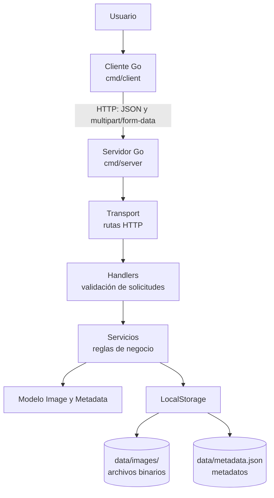

# Arquitectura de componentes - ImageFlow Fase 2

## Responsabilidad de los módulos

- `cmd/client`: punto de entrada del programa cliente y menú de usuario.
- `internal/client`: crea solicitudes HTTP y procesa respuestas del servidor.
- `cmd/server`: configura el almacenamiento e inicia el servidor HTTP.
- `internal/transport`: registra las rutas y conecta el servidor con los handlers.
- `internal/handlers`: interpreta solicitudes HTTP, obtiene campos y devuelve respuestas.
- `internal/services`: aplica reglas de negocio y validaciones del sistema de imágenes.
- `internal/models`: representa la entidad `Image`, sus metadatos y sus reglas de construcción.
- `internal/storage`: almacena los archivos y persiste los metadatos JSON.

## Flujo de carga

1. El usuario selecciona una imagen en el cliente Go.
2. El cliente crea una solicitud `POST /api/v1/images` con `multipart/form-data`.
3. El handler recibe el archivo y lo entrega al servicio.
4. El servicio valida nombre, tamaño y tipo del contenido.
5. El modelo crea la imagen con un ID generado por el servidor y sus metadatos.
6. El almacenamiento guarda el archivo y actualiza `metadata.json`.
7. El servidor responde con los metadatos en JSON.
8. El cliente muestra al usuario el resultado de la operación.

## Rutas disponibles

| Método | Ruta | Función |
|---|---|---|
| GET | `/health` | Comprobar disponibilidad del servidor. |
| POST | `/api/v1/images` | Cargar imagen. |
| GET | `/api/v1/images` | Consultar y filtrar. |
| GET | `/api/v1/images/{id}/download` | Descargar imagen. |
| DELETE | `/api/v1/images/{id}` | Eliminar imagen. |
